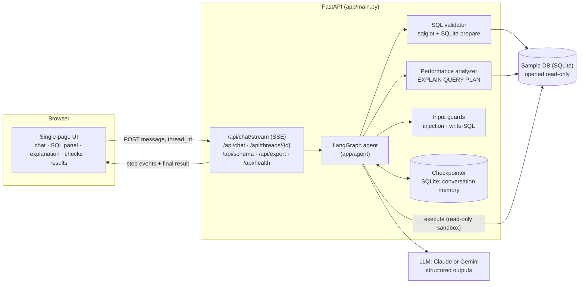
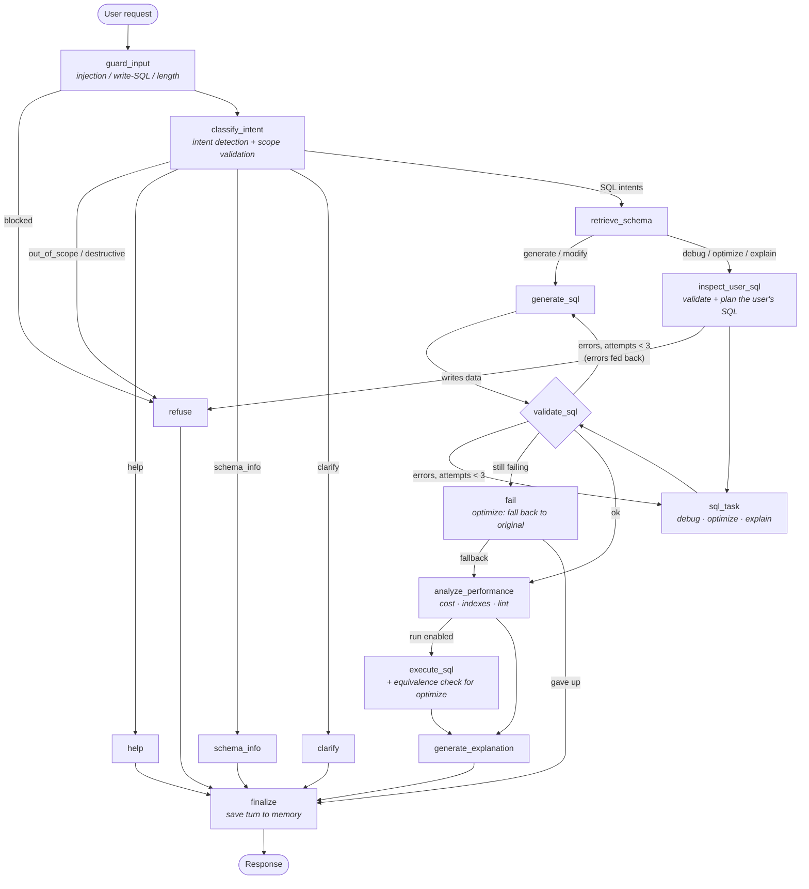

# Architecture

## System overview

* **Deterministic code does the checking; the LLM does the language work.** The model classifies
  intent, writes SQL, and explains it. Everything that must be true (read-only, real tables and
  columns, valid joins, valid SQLite, same results after an optimization) is verified in code.
* **One process, no external services** apart from the LLM API (Claude or Gemini, chosen by `LLM_PROVIDER`). SQLite holds both the
  sample data and the LangGraph checkpoints.

## LangGraph workflow

This extends the reference workflow in the brief (intent detection → scope validation → schema
retrieval → generation → validation → optimization → execution → explanation) in four ways:

1. **A guard before the LLM.** Prompt injection and statement-shaped write SQL are rejected without
   spending a model call.
2. **Routing by intent.** Debug, optimize and explain requests start from the user's SQL, so
   they take their own branch. That branch first validates the SQL and gathers the query plan,
   then hands those findings to the model as evidence.
3. **A validate-and-retry loop.** Validation errors are sent back to whichever node wrote the SQL
   (up to `MAX_SQL_ATTEMPTS`, default 3), so the model corrects itself against concrete messages
   such as `Unknown column 'Salry' on table Employees. Did you mean 'Salary'?`.
4. **An equivalence check for optimizations.** The original and the rewritten query both run, and
   if their results differ, the rewrite is discarded.

The auto-generated version of this graph (from the compiled LangGraph) is served at `GET /api/graph`.

### Nodes

| Node | Kind | What it does |
|---|---|---|
| `guard_input` | code | Resets per-turn state. Blocks empty or oversized input, prompt-injection patterns, and statement-shaped write SQL. Extracts pasted SQL. |
| `classify_intent` | LLM (effort low) | Chooses one of 10 intents, which also covers scope validation. Code then applies routing rules: a `modify` with no previous query becomes `generate`; `explain`/`optimize`/`debug` with no SQL uses the previous query or asks for one. |
| `retrieve_schema` | code | Picks relevant tables lexically, plus foreign-key neighbours. Schemas at or below `FULL_SCHEMA_TABLE_LIMIT` tables are sent whole (more accurate, and cacheable); larger schemas are sliced. |
| `generate_sql` | LLM (effort medium) | New question, or a follow-up built on `<previous_sql>`. Can answer "not answerable from this schema" instead of guessing. |
| `inspect_user_sql` | code | Validates and plans the user's SQL. A write → refuse. Invalid SQL sent for optimize/explain → re-routed to debug. |
| `sql_task` | LLM | Debug (issues + corrected SQL), optimize (rewrite + changes + indexes), or explain (plain English + steps). |
| `validate_sql` | code | The validator (below). Loops back to the producing node on failure. |
| `fail` | code | Stops after the maximum number of attempts. For optimize, falls back to the (valid) original query instead of failing. |
| `analyze_performance` | code | Estimates cost from EXPLAIN QUERY PLAN, suggests indexes, flags non-sargable predicates and correlated subqueries, and detects unused joins. |
| `execute_sql` | code | Runs the query in the read-only sandbox (row cap, timeout). For optimize, runs both versions and compares results. |
| `generate_explanation` | code | Assembles the explanation (written by the model in the same call as the SQL, so it always describes the final query) together with the execution facts, validation, performance data and dialect translations. |
| `refuse` / `help` / `schema_info` / `clarify` | code | Terminal responses. `schema_info` is answered directly from the catalog. |
| `finalize` | code | Appends the turn to `history` and updates `last_sql`, both persisted by the checkpointer. |

### State and memory

`AgentState` (in `app/agent/state.py`) has two parts:

* **Persistent**, kept across turns by the LangGraph checkpointer (keyed by `thread_id`):
  `history` (an append-only list of user and assistant turns, each with its SQL) and `last_sql`
  (the current working query). "Only those from California" is classified as `modify`, and
  `generate_sql` receives the previous query as `<previous_sql>` with instructions to change only
  what was asked.
* **Per-turn**: intent, candidate SQL, validation, performance, execution, trace, and so on. These
  are reset by `guard_input` at the start of every turn.

## Guardrails: defence in depth

| Layer | Where | Stops |
|---|---|---|
| 1. Input guard | `app/guards.py` | Prompt-injection phrasing, tag-breaking (`</user_message>`), statement-shaped writes (`DELETE FROM`, `DROP TABLE`, `UPDATE x SET`…), oversized input. Runs before any LLM call. |
| 2. Prompt design | `app/prompts.py` | User text is wrapped in tags and declared untrusted. The rules sit in a system prompt the user cannot edit. Schema-only, read-only, SQLite dialect. |
| 3. LLM classifier | `classify_intent` | Natural-language destructive requests ("delete all cancelled orders") and out-of-scope topics. |
| 4. SQL validator | `app/sql_validator.py` | Anything that is not a single read-only SELECT, checked on the whole syntax tree (so `WITH d AS (DELETE … RETURNING *)` and `SELECT … INTO` are caught). Also rejects unknown tables and columns, joins against undeclared keys, and SQL that SQLite cannot prepare. |
| 5. Database sandbox | `app/database.py` | The file is opened with `mode=ro`, the connection runs with `PRAGMA query_only=ON`, and an **authorizer callback** denies every action except reads (`load_extension`, `ATTACH`, `PRAGMA` and writes are all refused). Row cap and execution timeout. |
| 6. Result equivalence | `execute_sql` | An "optimized" query that changes the answer is never returned. |

Layers 4 and 5 are independent of the LLM, so even a fully compromised model cannot modify the database.

## Key design decisions

* **Structured outputs everywhere.** Each LLM call returns a Pydantic model (`app/llm.py`) through
  the Anthropic SDK's `messages.parse`, so no free text is parsed.
* **Explanation in the same call as the SQL.** This saves a model round-trip per request. Because
  the call is redone on each retry, the explanation cannot describe an earlier, rejected query.
* **A single, cached system prompt.** Rules and schema are byte-identical on every call and marked
  with `cache_control`, so repeated calls reuse the cached prefix.
* **Column values and date ranges in the schema prompt.** Listing `State` values `'AZ', 'CA', …`
  and a `HireDate` range is what lets "California" become `State = 'CA'` without guessing.
* **The engine as the final arbiter.** `EXPLAIN QUERY PLAN` makes SQLite prepare the statement.
  That catches dialect errors (`YEAR()`, `DATEDIFF()`) and ambiguous columns that a generic parser
  accepts, and the plan it returns feeds the cost estimate.
* **LLM behind a protocol.** Nodes depend on `StructuredLLM`, so tests swap in a scripted fake and
  the graph can be tested offline and deterministically.
